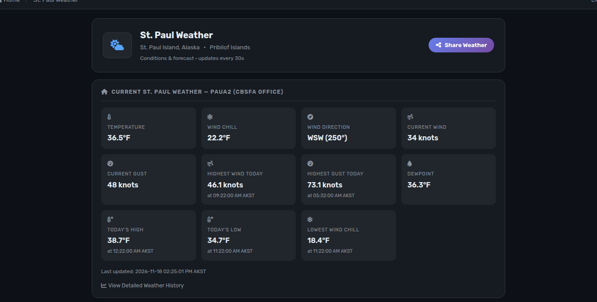
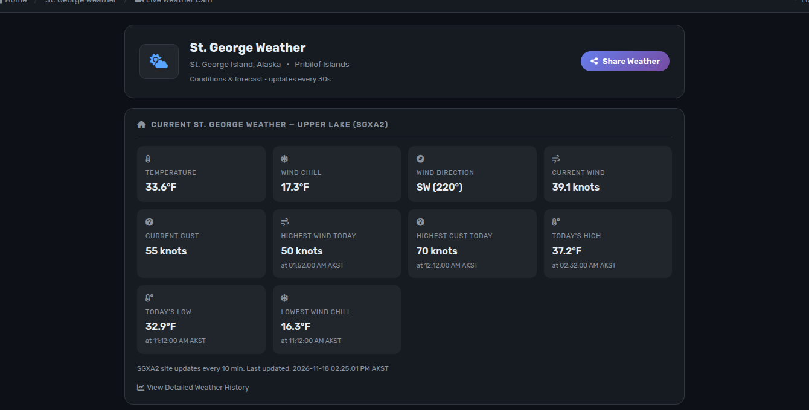

# Wind Watch

A small Docker service that follows the wind at two weather stations in the Pribilof Islands, Alaska. Every ten minutes it reads the public observations from the NOAA National Data Buoy Center (NDBC), converts them to the units people here use, and writes plain JSON files that a website can read.

It was written for St. Paul Island and St. George Island, but nothing in it is tied to them. The station list is a small config file, so you can point it at any NDBC station that publishes standard meteorological data: see [Using your own stations](#using-your-own-stations).

## On pribiloftraffic.com

The JSON files show up on three pages. [Island Battle](https://www.pribiloftraffic.com/pribobs/) puts the two stations side by side. [St. Paul weather](https://www.pribiloftraffic.com/snpweather/) reads PAUA2, and [St. George weather](https://www.pribiloftraffic.com/stgweather/) reads SGXA2.

As the pages looked on the afternoon of 18 Nov 2026.






The Docker setup on the island started from the SDR Enthusiasts guide, [ADS-B Reception, Decoding & Sharing with Docker](https://sdr-enthusiasts.gitbook.io/ads-b).

## What it does

- Fetches each station's `realtime2` text file from NDBC (about 45 days of observations), and skips the download when NDBC has nothing newer than last time.
- Converts wind from m/s to knots and temperature from °C to °F, adds a compass direction (`SE`) next to the degrees, and works out wind chill.
- Shows times in local time with the right label for the season (AKST in winter, AKDT in summer). Every reading also carries its UTC time.
- Keeps daily highs and lows for each station: strongest wind, strongest gust, warmest, coldest, lowest wind chill. Days start at local midnight.
- Writes one archive file per station per finished day, so history outlives NDBC's 45-day window.
- Marks a station `offline` when its newest reading is too old (30 minutes unless you set otherwise), and records when the outage began and how long the last one lasted.
- When a fetch fails, works out whose end the problem is on (see "When something goes wrong").

It only writes files. It does not serve a web API.

## The stations

### St. Paul Island (PAUA2)
- Location: St. Paul Island Airport
- Coordinates: 57.167N 170.220W
- Elevation: 63 feet above sea level
- Equipment: automated airport weather station

### St. George Island (SGXA2)
- Location: St. George Island
- Coordinates: 56.600N 169.557W
- Elevation: 125 feet above sea level
- Equipment: automated weather station

Both stations report over satellite internet. Heavy weather, solar activity, power dips and maintenance windows all cause gaps, sometimes for weeks. A station going quiet is normal out here, which is why the service tracks outages instead of treating them as errors.

## Quick start

You need Docker with the Compose plugin, and outbound HTTPS to `www.ndbc.noaa.gov`.

```bash
git clone https://github.com/PribilofTraffic/wind_watch.git
cd wind_watch
cp docker-compose.example.yml docker-compose.yml
docker compose up -d
```

Files appear under `./data/wind_watch/` within a few seconds. `docker compose ps` shows the container as `healthy` after about a minute.

Out of the box it follows the two Pribilof stations. The next section shows how to follow yours.

## Using your own stations

1. Find your station on the map at <https://www.ndbc.noaa.gov/> and note its id (for example `44013` for the Boston approach buoy, or `BURL1` for Southwest Pass, Louisiana).
2. Check that it reports wind: `https://www.ndbc.noaa.gov/data/realtime2/<ID>.txt` should open and show rows of numbers.
3. Put the ids in `stations.json`:

   ```json
   {
     "stations": [
       { "id": "44013", "name": "Boston Approach" },
       { "id": "BURL1", "name": "Southwest Pass", "stale_threshold_min": 90 }
     ],
     "output": { "current": { "update_interval": 600 } }
   }
   ```

4. Set `TZ` in `docker-compose.yml` to your own time zone.
5. Restart: `docker compose up -d --force-recreate`.

Only `id` is required for a station:

| Field | Default | Meaning |
|---|---|---|
| `id` | required | the NDBC station id; also the name of the output files |
| `name` | the id | the name shown in the output |
| `stale_threshold_min` | `STALE_THRESHOLD_MIN` (30) | minutes without a new reading before this station counts as offline |
| `source_45day` | NDBC's address for the id | full URL of the observations file, if you need to override it |

**Set `stale_threshold_min` for stations that report hourly.** Many buoys and coastal stations publish once an hour, and NDBC posts each reading some minutes after it was taken. With the 30-minute default such a station shows as offline for much of every hour. 90 is a reasonable value for an hourly station.

Things that are fixed: wind is in knots and temperature in °F, and a station that does not report a value (no dewpoint sensor, for example) gets `null` for it.

## What it writes

Everything goes under `data/wind_watch/`:

| File | What it holds | Updated |
|---|---|---|
| `YYYY/<STATION>.json` | latest reading, status, and daily highs and lows for the last 45 days | every cycle |
| `status/<STATION>_status.json` | online or offline, last outage, and the cause of a failure | every cycle |
| `daily/YYYY/<STATION>_<YYYY-MM-DD>.json` | the highs and lows for one finished day | once, when the day ends |

`YYYY` is the current UTC year.

The current file looks like this (one day of `daily_stats` shown):

```json
{
  "station": { "id": "PAUA2", "name": "St. Paul" },
  "last_update": "2026-11-16 07:13:50 PM AKST",
  "current": {
    "utc": "2026-11-17T03:52:00+00:00Z",
    "date": "2026-11-16",
    "time": "06:52:00 PM AKST",
    "wind": 15.9,
    "gust": 26.0,
    "direction": { "degrees": 130, "cardinal": "SE" },
    "temperature": 34.3,
    "dewpoint": 27.5,
    "windchill": 23.5
  },
  "status": "online",
  "stale": { "is_stale": false, "age_minutes": 21, "threshold_min": 30 },
  "daily_stats": {
    "2026-11-16": {
      "max_wind": { "value": 21.0, "time": "06:32:00 PM AKST", "utc": "2026-11-17T03:32:00+00:00Z" },
      "max_gust": { "value": 32.1, "time": "12:52:00 AM AKST", "utc": "2026-11-16T09:52:00+00:00Z" },
      "max_temp": { "value": 34.3, "time": "06:52:00 PM AKST", "utc": "2026-11-17T03:52:00+00:00Z" },
      "min_temp": { "value": 30.7, "time": "09:52:00 AM AKST", "utc": "2026-11-16T18:52:00+00:00Z" },
      "min_windchill": { "value": 20.5, "time": "07:02:00 AM AKST", "utc": "2026-11-16T16:02:00+00:00Z" }
    }
  }
}
```

Wind and gust are in knots, temperatures in °F.

Files are written to a temporary name and then renamed, so a web server reading the folder never sees a half-written file.

### The archive

A finished day's file is written once. It is rewritten only if its content changed and the day is within the last three days, which picks up observations that arrive late. Older files are never touched, so the archive is safe to back up or copy at any time.

## Settings

The station list (see above) and the polling interval live in `stations.json`. `update_interval` is in seconds. NDBC refreshes its files about every ten minutes, so a shorter interval only asks for the same file again.

The rest are environment variables, all optional:

| Variable | Default | Meaning |
|---|---|---|
| `TZ` | `America/Anchorage` | time zone for displayed times and for where a day starts |
| `USER_AGENT` | `wind-watch-collector/1.1` | how the service identifies itself to NDBC |
| `FETCH_TIMEOUT` | `30` | seconds to wait for NDBC on each try |
| `FETCH_RETRIES` | `3` | tries per station per cycle |
| `STALE_THRESHOLD_MIN` | `30` | a reading older than this many minutes marks the station offline (a station's own `stale_threshold_min` wins) |
| `BACKFILL_DAYS` | `3` | how many days back a finished archive file may still be rewritten |
| `NDBC_URL` | `https://www.ndbc.noaa.gov/data/realtime2/{id}.txt` | where a station's file is found when `stations.json` gives no URL |
| `CONNECTIVITY_PROBES` | `1.1.1.1:443,8.8.8.8:53` | hosts used to check that our own internet is up |
| `DNS_PROBE_HOST` | `dns.google` | name used to check that DNS works |

## When something goes wrong

A failed fetch is sorted into one of four causes, written to the log and to the station's status file as `cause` and `cause_detail`:

| Cause | Meaning |
|---|---|
| `local_network` | our own internet or DNS is down |
| `source_down` | our internet works, but NDBC does not answer or returns a server error |
| `source_stale` | NDBC answers, but the station has stopped reporting |
| `our_error` | NDBC answered and we could not use it: format changed, URL moved, or we were refused or rate-limited |

The first three fix themselves when the link or the station comes back. Only `our_error` needs someone to look at the code.

## Health check

The container is `healthy` while the loop keeps rewriting the status files (each one within three polling intervals). A station being offline does not make the container unhealthy, because restarting it would not bring the station back.

## Logs

The service logs to the container output (`docker compose logs -f wind-watch`) and to `logs/wind.log`, which rotates at midnight and keeps 30 days.

## Running without Docker

Python 3.9 or newer:

```bash
pip install -r requirements.txt
python wind_data_converter.py
```

The paths `/app/config/stations.json` and `/app/data` are fixed in the code, so Docker is the easier way to run it.

## Data source

Observations come from the [NOAA National Data Buoy Center](https://www.ndbc.noaa.gov/). This project is not affiliated with NOAA.

## Where this came from

The idea is older than the AI help. It began years ago as a hand-written script comparing the wind on two
islands forty miles apart.
It was written and run that way, without AI, long before any was involved.

AI came later, as an assistant. Claude helped tidy the code, add tests, find
bugs and package it as a container other people can run. The ideas, and the
judgement about what matters on these islands, are the maintainer's own.

Most of the Pribilof Traffic collectors started on Raspberry Pis, and
Raspberry Pis on the islands still run the webcam and the aircraft (tar1090)
and ACARS receivers today.

## License

MIT. See [LICENSE](LICENSE).
